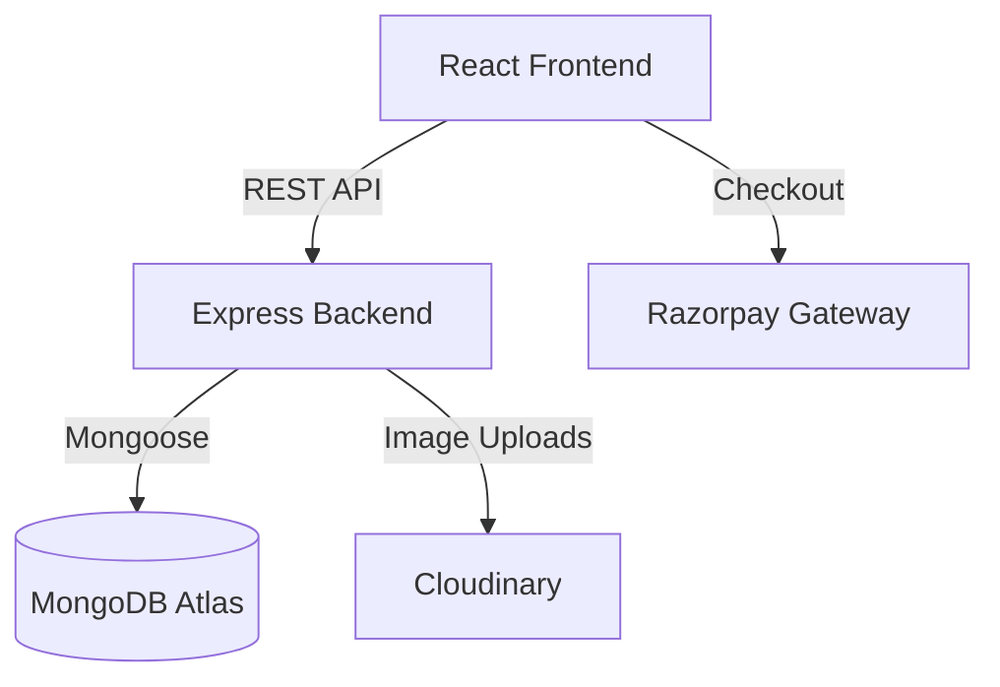

# 🛒 SHOPEZ — Premium E-Commerce Platform

Welcome to the **SHOPEZ** repository! SHOPEZ is a full-stack, enterprise-grade e-commerce application built with the MERN stack (MongoDB, Express, React, Node.js). It offers a seamless, secure, and modern shopping experience with advanced features like Razorpay payment integration, Cloudinary image management, and a robust admin dashboard.


---

## 🌟 Features

### For Users
- **Secure Authentication:** JWT-based login, registration, and profile management.
- **Product Browsing:** Advanced search, filtering, and pagination.
- **Shopping Cart:** Dynamic cart state management, quantity updates, and persistent storage.
- **Checkout & Payments:** Secure payment processing via **Razorpay**.
- **Order Tracking:** Detailed order history and status tracking.

### For Administrators
- **Dashboard Analytics:** High-level overview of total sales, users, and products.
- **Product Management:** Full CRUD capabilities with drag-and-drop Cloudinary image uploads.
- **Order Management:** Update order statuses (Processing, Shipped, Delivered, Cancelled).
- **User Management:** Manage roles, and block/unblock accounts.

---

## 💻 Tech Stack

- **Frontend:** React 18, Vite, React Router DOM v6, Context API, Bootstrap, Axios.
- **Backend:** Node.js, Express.js, MongoDB (Mongoose).
- **Security:** Helmet, express-rate-limit, express-mongo-sanitize, xss-clean, bcryptjs, jsonwebtoken.
- **File Storage:** Cloudinary & Multer.
- **Payments:** Razorpay.
- **Testing:** Jest & Supertest.

---

## 🏛️ Architecture

SHOPEZ utilizes a split-repository structure:
- `/frontend`: The React SPA built with Vite.
- `/backend`: The Node.js/Express REST API utilizing a Service-Controller pattern.



---

## 🚀 Installation & Local Setup

### 1. Clone the repository
```bash
git clone https://github.com/yourusername/shopezz.git
cd shopezz
```

### 2. Setup the Backend
```bash
cd backend
npm install
cp .env.example .env  # Configure your environment variables
npm run dev
```

### 3. Setup the Frontend
```bash
cd ../frontend
npm install
cp .env.example .env  # Configure your environment variables
npm run dev
```

---

## 🔐 Environment Variables

You need to set up environment variables in both `/backend` and `/frontend`.

**Backend (`backend/.env`):**
```env
NODE_ENV=development
PORT=5000
MONGO_URI=mongodb+srv://<user>:<password>@cluster.mongodb.net/shopez
JWT_SECRET=your_jwt_secret
CLIENT_URL=http://localhost:5173
CLOUDINARY_CLOUD_NAME=your_cloud_name
CLOUDINARY_API_KEY=your_api_key
CLOUDINARY_API_SECRET=your_api_secret
RAZORPAY_KEY_ID=rzp_test_your_key
RAZORPAY_KEY_SECRET=your_razorpay_secret
RATE_LIMIT_WINDOW=15
RATE_LIMIT_MAX=100
```

**Frontend (`frontend/.env`):**
```env
VITE_API_URL=http://localhost:5000/api
VITE_RAZORPAY_KEY_ID=rzp_test_your_key
```

---

## 📚 Documentation
For deeper dives into the architecture and API, please refer to the extensive documentation files located in the root directory:
- [API_DOCUMENTATION.md](./API_DOCUMENTATION.md)
- [DATABASE_DOCUMENTATION.md](./DATABASE_DOCUMENTATION.md)
- [USER_MANUAL.md](./USER_MANUAL.md)
- [DEVELOPER_GUIDE.md](./DEVELOPER_GUIDE.md)

---

## 🌍 Deployment

- **Backend:** Configured for [Render](https://render.com) using the included `render.yaml` file.
- **Frontend:** Configured for [Vercel](https://vercel.com) using the included `frontend/vercel.json` file for SPA routing.

*(See the generated `deploy_*` artifacts for full deployment steps).*

---

## 🐛 Troubleshooting
- **CORS Errors:** Ensure your `CLIENT_URL` in the backend exactly matches your frontend URL (no trailing slashes).
- **Database Connection:** Ensure your current IP address is whitelisted in MongoDB Atlas.

---
*Developed with ❤️ as a portfolio showcase.*
